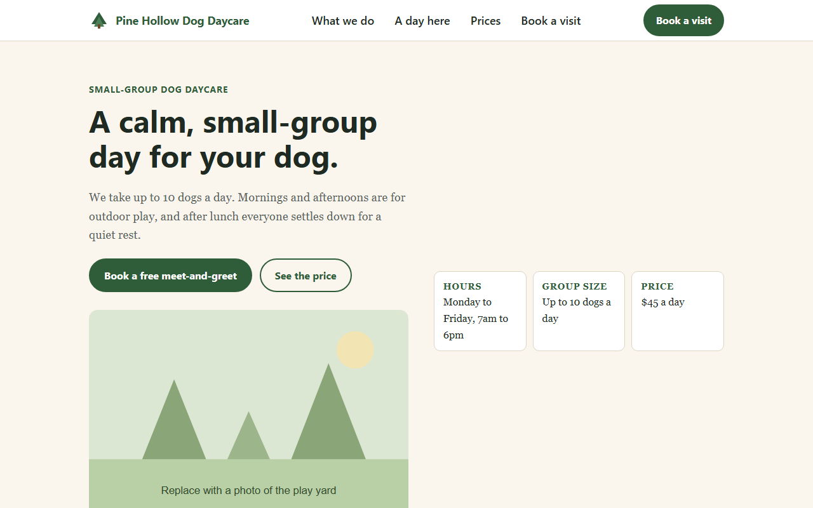

# 01. A small business website, built with AI in one sitting

You will build a one-page website for a small business, check it on a phone, and add a section that answers the questions customers ask every day.

The business in this folder, Pine Hollow Dog Daycare, is made up. Swap in your own facts when you are ready.

**Video:** link added when the video is out. Channel: [youtube.com/@FrancoCelesteAI](https://www.youtube.com/@FrancoCelesteAI)

## What one run produced

This came from Prompt 1 alone, with nothing changed by hand. Yours will look different. AI does not make the same page twice.

## What is in this folder

| File | What it is |
|---|---|
| `PROMPTS.md` | The five prompts from the video, ready to copy |
| `business-facts.md` | The made-up facts the website is built from. Replace them with yours. |
| `CLAUDE.md` | Plain instructions that tell the AI how to behave in this folder. Way B reads it by itself. |
| `.claude/skills/site-check/` | A small skill for Way B. Type `/site-check` and the AI checks the page for you. |

## Way A: no setup (2 minutes)

1. Open `business-facts.md` and `PROMPTS.md`.
2. In any AI chat, paste the facts, then paste Prompt 1.
3. The chat gives you the website as code. Ask it: "How do I save this and open it in my browser?"

This works, and it shows you the idea. You will be copying and pasting by hand, and the chat cannot open or check the page for you.

## Way B: the same setup as the video (about 10 minutes the first time)

1. Do [SETUP.md](../SETUP.md) once.
2. Open this folder in the Claude desktop app (Code tab, Open folder).
3. Type the prompts from `PROMPTS.md` one at a time. Look at the result after each one.
4. Type `/site-check` at the end.

## Make it yours

1. Replace everything in `business-facts.md` with your real hours, prices and rules.
2. Replace the six questions in Prompt 5 with the six your customers really ask.
3. Run the prompts again.

## Before a real customer sees it

- Read every word. Fix anything that is not true for your business.
- Replace the placeholder pictures with your own photos.
- Check it on your own phone.
- Putting it online needs a domain name and somewhere to host it. Prices change, so check them yourself.

## What can go wrong

- **It invents something.** That is why `CLAUDE.md` says to write "ask us" when a fact is missing. If you see an invented fact, tell it which line is wrong and give it the right one.
- **It looks different from the video.** It will. AI does not make the same page twice. Tell it what you want changed, in plain words.
- **A button does nothing.** Say so: "The button at the top does nothing. Make it scroll to the booking section."
