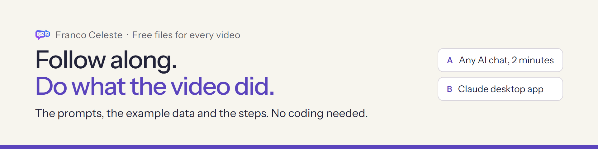

<picture>
  <source media="(prefers-color-scheme: dark)" srcset="assets/header-dark.png">
  
</picture>

# Follow along

Free files for the videos at [youtube.com/@FrancoCelesteAI](https://www.youtube.com/@FrancoCelesteAI).

Each video shows one business problem fixed with AI, start to finish. Each folder here holds what was used on screen, so you can do it yourself. You do not need to be technical.

## Pick the way that fits you

| | Way A: no setup | Way B: the same setup as the video |
|---|---|---|
| **Good for** | Trying it right now | Building real files, the way the video does |
| **You need** | A browser and any AI chat (Claude, ChatGPT, Gemini) | The Claude desktop app and a paid Claude plan |
| **Time** | 2 minutes | About 10 minutes the first time |
| **What you do** | Open the folder's `PROMPTS.md`, copy a prompt, paste it into your AI chat | Follow [SETUP.md](SETUP.md) once, then open the folder in the app |

Way A gives you the words. Way B lets the AI build real files on your computer, the way it does in the video.

There is a third way: have it done for you, or learn it one to one. That is paid work, and it is at [logictalk.ai](https://logictalk.ai/). To talk it through first, [book a free call](https://calendly.com/franco-logictalk/free-ai-diagnosis?utm_source=github&utm_medium=follow-along).

## The folders

| Folder | What you build | Video |
|---|---|---|
| [01-website-in-one-sitting](01-website-in-one-sitting/) | A one-page website for a small business, with a section that answers the questions customers ask every day | Link added when the video is out |

More folders arrive with each video.

## How to download a folder (no account needed)

1. Click the green **Code** button near the top of this page.
2. Click **Download ZIP**.
3. Open the zip and drag the folder you want to your Desktop.

## Three rules worth keeping

1. **AI drafts. You check.** Read everything before a customer sees it.
2. **Give it facts.** Hours, prices, policies. The more real facts it has, the less it makes up.
3. **Keep private things out.** No customer card numbers, health details or passwords in any AI tool.

## What this is not

Every business in these folders is made up. Nothing here is legal, financial or tax advice. AI tools make mistakes, and results vary.

## License

MIT. Copy it, change it, use it in your business. Made by [Logic Talk AI](https://logictalk.ai/).
